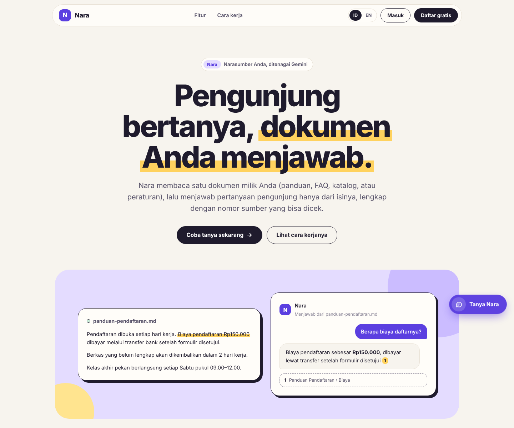

# Nara — Narasumber Anda

Platform chatbot dokumen. Daftar, unggah **satu dokumen** (panduan, FAQ, katalog, peraturan), lalu pasang bot yang menjawab pengunjung **hanya dari isi dokumen itu**, lengkap dengan nomor sumber yang bisa diklik. Berjalan di paket gratis **Cloudflare Workers** dengan **Gemini** sebagai model utama.

- **Situs:** https://nara.panduarahid.workers.dev
- **Dashboard:** https://nara.panduarahid.workers.dev/admin



## Fitur

- **Pengunjung:** widget chat dengan sitasi `[n]`, jawaban streaming, dua bahasa (ID/EN), tampilan penuh di HP. Juga tersedia lewat Telegram dan WhatsApp untuk bot platform.
- **Pemilik bot:** akun gratis 7 hari, maksimal 3 bot; unggah .md, .txt, .pdf, .docx, .html, .csv, atau .json; atur tampilan dan urutan model; uji coba dengan panel X-ray; riwayat pertanyaan; kode widget siap salin.
- **Mutu jawaban:** pencarian hibrida (vektor + BM25), gerbang skor sebelum AI, reranker otomatis untuk dokumen berbahasa Inggris, cek sitasi setelah jawaban dibuat, dan failover antar-penyedia.
- **Hemat token:** sapaan, pertanyaan di luar dokumen, dan upaya prompt injection dijawab tanpa AI. Pertanyaan yang sama atau mirip dijawab dari cache.
- **Keamanan:** isolasi data per bot, penyamaran data pribadi, riwayat bertanda tangan, dan tiga kali audit (lihat [`SECURITY.md`](SECURITY.md)).


## Stack

| Lapisan | Teknologi |
|---|---|
| Runtime | Cloudflare Workers + [Hono](https://hono.dev) (TypeScript) |
| Data | D1 (SQLite + FTS5), Vectorize (1024 dimensi) |
| AI | Gemini, Workers AI (bge-m3, bge-reranker, GLM/Llama cadangan), serta DeepSeek, Kimi, GLM, Groq, OpenRouter, Hugging Face, dan lainnya |
| Frontend | HTML/CSS/JS tanpa framework; widget berupa Web Component |
| QA & CI/CD | Playwright, `node:test`, GitHub Actions → `wrangler deploy` |

## Cara kerja

```
pertanyaan → kuota & anti-bot → sapaan? → prompt injection? → cache (sama persis / makna mirip)?
           → tulis ulang pertanyaan lanjutan → vektor ∥ BM25 → RRF → gerbang skor → rerank (opsional)
           → prompt 7 layer + rantai model → cek sitasi & data pribadi → stream ke pengunjung (+ simpan ke cache)
```

Setiap tanda tanya di atas bisa langsung menjawab tanpa memanggil AI. Dokumen dipotong per judul bagian di browser, lalu di-embed dan disimpan per bot. Setiap query ke D1 dan Vectorize dibatasi ke bot yang sedang menjawab.

## Struktur

```
src/
  index.ts      route publik, akun, admin, cron, kuota
  rag.ts        retrieval hibrida, prompt, pipeline jawaban
  llm.ts        rantai penyedia, streaming, embedding
  cache.ts      cache jawaban semantik
  guard.ts      deteksi data pribadi & prompt injection, riwayat bertanda tangan
  grounding.ts  cek sitasi, deteksi bahasa dokumen
  auth.ts  settings.ts  smalltalk.ts  channels.ts  channel-format.ts  types.ts
public/         landing page, dashboard (admin.html), widget
migrations/     skema D1
tests/          unit, ui, worker
docs/           dokumen referensi bot demo, rekaman audit, screenshot
```

## Menjalankan di lokal

Butuh Node.js 22.18+.

```bash
npm install
```

```bash
npm run dev:mock
```

Perintah di atas menjalankan server mock di http://127.0.0.1:8787 tanpa akun Cloudflare (password admin `dev`). Untuk Worker asli, salin `.env.example` ke `.dev.vars` lalu jalankan `npm run dev`. Untuk menjalankan semua test:

```bash
npm run qa
```

## Deploy

1. Buat API token Cloudflare dengan izin *Workers Scripts*, *D1*, *Vectorize* (Edit), serta *Workers AI* dan *Account Settings* (Read).
2. Di GitHub **Settings → Secrets and variables → Actions**, isi `CLOUDFLARE_API_TOKEN`, `CLOUDFLARE_ACCOUNT_ID`, `ADMIN_PASSWORD`, dan sebaiknya `GEMINI_API_KEY`. Secret opsional lain (penyedia tambahan, Telegram, WhatsApp) tercantum di `.github/workflows/deploy.yml`.
3. Push ke `main`, atau jalankan **Actions → Deploy to Cloudflare**.

Workflow menjalankan QA, lalu menyiapkan D1, Vectorize, migrasi, dan secret, men-deploy Worker, dan mengindeks `docs/knowledge/nara.md` untuk bot demo.

## Pasang widget

```html
<script src="https://nara.panduarahid.workers.dev/widget.js" defer></script>
<tanyasaya-chat api-base="https://nara.panduarahid.workers.dev" bot="<id-bot>"></tanyasaya-chat>
```

Atribut opsional: `position="left"`, `theme="dark|auto"`, `lang="id|en"`.

## Lisensi

[Apache License 2.0](LICENSE) © 2026 devaldicaliesta. Cache jawaban meniru rancangan [GPTCache](https://github.com/zilliztech/GPTCache) (MIT, © Zilliz) tanpa menyertakan kodenya; atribusinya ada di [`NOTICE`](NOTICE).
