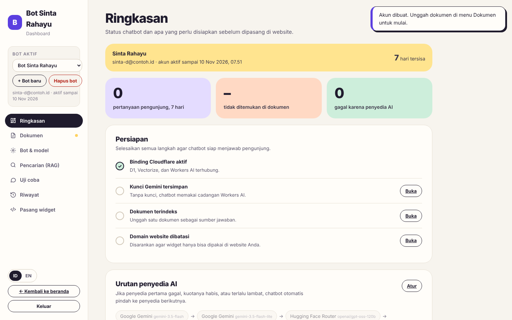

# Nara — Narasumber Anda

Nara adalah platform chatbot dokumen. Siapa pun bisa mendaftar, mengunggah **satu dokumen** (panduan, FAQ, katalog, atau peraturan), lalu memasang bot yang menjawab pertanyaan pengunjung **hanya dari isi dokumen itu**, lengkap dengan **nomor sumber** yang bisa diklik. Seluruh layanan berjalan di paket gratis **Cloudflare Workers**, dengan **Gemini** sebagai model utama.

- **Situs:** https://nara.panduarahid.workers.dev
- **Dashboard:** https://nara.panduarahid.workers.dev/admin


## Daftar isi

1. [Fitur](#fitur)
2. [Stack teknologi](#stack-teknologi)
3. [Arsitektur](#arsitektur)
4. [Alur kerja](#alur-kerja)
5. [Struktur proyek](#struktur-proyek)
6. [Model data](#model-data)
7. [API](#api)
8. [Konfigurasi: secret dan variabel](#konfigurasi-secret-dan-variabel)
9. [Menjalankan di lokal](#menjalankan-di-lokal)
10. [Deploy](#deploy)
11. [Akun, bot, dan batas pemakaian](#akun-bot-dan-batas-pemakaian)
12. [Penyedia model](#penyedia-model)
13. [Widget](#widget)
14. [Telegram dan WhatsApp](#telegram-dan-whatsapp)
15. [Keamanan](#keamanan)
16. [QA dan pengujian](#qa-dan-pengujian)
17. [Batas paket gratis Cloudflare](#batas-paket-gratis-cloudflare)
18. [Pemecahan masalah](#pemecahan-masalah)
19. [Perlu diverifikasi (VERIFY)](#perlu-diverifikasi-verify)
20. [Riwayat versi](#riwayat-versi)
21. [Lisensi](#lisensi)

## Fitur

| Untuk | Fitur |
|---|---|
| Pengunjung | Widget chat yang menjawab dari dokumen dengan sitasi `[n]` yang bisa diklik, jawaban streaming, dua bahasa (ID/EN), balasan ramah untuk sapaan, tampilan layar penuh di HP |
| Pemilik bot | Daftar dengan email; maksimal 3 bot per akun; unggah .md, .txt, .pdf, .docx, .html, .csv, atau .json; atur nama, warna, sapaan, dan urutan model; uji coba dengan panel "X-ray" hasil pencarian; riwayat pertanyaan; kode widget siap salin |
| Pengelola platform | Bot demo "Nara" di landing page, admin lewat `ADMIN_PASSWORD`, saluran Telegram dan WhatsApp, deploy otomatis, cron pembersihan akun |
| Mutu jawaban | Pencarian hibrida (vektor + kata kunci), gerbang skor yang menolak sebelum AI dipanggil, penulisan ulang pertanyaan lanjutan, cadangan antar-penyedia, dan potongan dokumen ditampilkan bila semua AI habis kuota |



## Stack teknologi

| Lapisan | Teknologi | Peran |
|---|---|---|
| Runtime | **Cloudflare Workers** + [Hono](https://hono.dev) 4 (TypeScript strict) | API, autentikasi, pipeline RAG, cron |
| Basis data | **Cloudflare D1** (SQLite) + **FTS5** | Akun, sesi, bot, potongan dokumen, indeks kata kunci, pengaturan, log, kuota |
| Pencarian vektor | **Cloudflare Vectorize** (1024 dimensi, cosine, metadata index `bot`) | Pencarian makna per bot |
| AI di Cloudflare | **Workers AI**: `@cf/baai/bge-m3` (embedding), `@cf/zai-org/glm-4.7-flash` dan `@cf/meta/llama-3.1-8b-instruct-fast` (chat cadangan), `@cf/baai/bge-reranker-base` (rerank opsional) | Model gratis dan cadangan |
| LLM eksternal | Gemini (`gemini-3.5-flash`, `gemini-embedding-2`), DeepSeek, Kimi, GLM, Groq, OpenRouter, Cerebras, SambaNova, Hugging Face | Endpoint yang kompatibel dengan OpenAI |
| Frontend | HTML/CSS/JS tanpa framework; widget berupa **Web Component** di Shadow DOM; parser dokumen di browser (pdf.js, mammoth) | Landing page, dashboard, widget |
| Desain | Plus Jakarta Sans, kanvas krem, blok pastel, tombol pill, kartu "stiker" | Satu bahasa visual di semua halaman |
| Pengujian | **Playwright** 1.63 (UI + Worker lokal), `node:test` | QA otomatis |
| CI/CD | **GitHub Actions** → `wrangler deploy` | QA wajib lulus sebelum deploy |
| Saluran lain | Telegram Bot API, WhatsApp Cloud API (Meta) | Bot platform saja |

## Arsitektur

```
                 ┌──────────────────────── Browser ────────────────────────┐
                 │ Landing page (index.html)   Dashboard (admin.html)      │
                 │ Widget <tanyasaya-chat bot="…">   parse + chunk dokumen │
                 └───────────────┬───────────────────────────┬─────────────┘
                     /api/public/*                 /api/auth/*, /api/admin/*
                                 ▼                           ▼
┌──────────────────────────── Cloudflare Worker (src/index.ts) ───────────────────────────┐
│ CORS + kuota + honeypot       Akun & sesi (auth.ts)      Admin per bot (X-Bot-Id)       │
│            │                          │                          │                      │
│            ▼                          ▼                          ▼                      │
│   answer() ── smalltalk.ts ── rag.ts (rewrite → hybrid retrieve → gate → prompt 7 layer)│
│            │                                     │                                      │
│            ▼                                     ▼                                      │
│   llm.ts: rantai penyedia + failover      embed() untuk unggahan                        │
│  Telegram / WhatsApp webhooks (channels.ts)    Cron harian: hapus akun kedaluwarsa      │
└──────┬───────────────┬────────────────┬────────────────┬────────────────────────────────┘
       ▼               ▼                ▼                ▼
   D1 + FTS5       Vectorize        Workers AI     Gemini / DeepSeek / Kimi / GLM / …
```

Setiap request bekerja untuk satu bot:
- Widget mengirim `?bot=<id>`; tanpa id, yang dipakai bot platform `default`.
- Dashboard mengirim `X-Bot-Id`, dan server mengecek bahwa bot itu milik pengguna yang sedang login.
- Semua query D1, query Vectorize, kunci API, kuota, dan log dibatasi ke bot tersebut.

## Alur kerja

### 1. Alur pemilik bot
1. Klik **Daftar gratis** di landing page, lalu isi nama, email, dan kata sandi minimal 10 karakter. Akun langsung mendapat satu bot dan aktif selama 7 hari.
2. Di menu **Dokumen**, pilih file. Dokumen dibaca dan dipotong per judul bagian langsung di browser.
3. Di menu **Bot & model**, atur nama, warna, sapaan, dan urutan model. Kunci API sendiri boleh ditempel di sini.
4. Di menu **Uji coba**, ajukan pertanyaan lalu lihat panel "Hasil pencarian": potongan yang ditemukan, skornya, dan apakah pertanyaan diteruskan ke AI.
5. Di menu **Pasang widget**, salin dua baris kode (sudah berisi `bot="<id>"`) ke website Anda.

### 2. Alur unggah dokumen
```
browser: baca file → bagi per judul (#, ##) → potong ±1000 karakter + tumpang-tindih kalimat
   → POST /api/admin/file            (catat file, pilih embedder: Gemini bila ada kunci, selain itu bge-m3)
   → POST /api/admin/file/chunks ×N  (20 potongan per batch → embed → D1 chunks + FTS5 + Vectorize {bot, idx})
   → POST /api/admin/file/done       (status selesai, buat 4 saran pertanyaan dalam ID dan EN)
```
Parsing dilakukan di browser supaya Worker tidak menghabiskan CPU. Bot pengguna dibatasi 400 potongan per dokumen.

### 3. Alur menjawab pertanyaan
```
widget → POST /api/public/chat?bot=<id>
  1. honeypot, User-Agent, status bot (aktif / kedaluwarsa), batas per menit, kuota harian
  2. basa-basi ("halo", "makasih", "kamu siapa?") → balasan tetap, tanpa AI
  2a. guardrail input: pola prompt injection → balasan tetap, tanpa AI; riwayat "assistant" tanpa tanda tangan HMAC dibuang
  2b. cache jawaban (pola GPTCache, hanya pertanyaan tanpa riwayat): sama persis → jawab dari cache tanpa AI;
      kalau tidak, embedding pertanyaan dibandingkan dengan pertanyaan lama (cosine ≥ ambang, angka harus sama)
      → jawab dari cache; meleset → embedding yang sama dipakai ulang untuk pencarian di bawah
  3. pertanyaan lanjutan ditulis ulang menjadi pertanyaan mandiri
  4. pencarian vektor (filter bot) ∥ pencarian kata kunci FTS5 (bot_id) → Reciprocal Rank Fusion
  5. gerbang skor: tidak ada yang cukup mirip → pesan penolakan, tanpa AI
  6. rerank (opsional; otomatis menyala untuk dokumen berbahasa Inggris) → top-K → gabung potongan tetangga → cek ulang bot_id di D1
  7. prompt 7 layer (dokumen hanya di giliran user, sebagai data) → rantai model dengan failover
  8. jawaban di-stream (NDJSON); [n] menjadi tombol sumber; semua penyedia gagal → potongan dokumen + pesan ramah
  9. cek sitasi tanpa AI: [n] yang tidak merujuk potongan yang dikirim dibuang (teks final dikirim di event `done`);
     jawaban tanpa satu pun sitasi valid ditandai "Tanpa sitasi" di Riwayat dan tidak disimpan ke cache
  10. guardrail output: data pribadi (NIK, kartu, NPWP, rekening, email, HP) yang tidak ada di dokumen disamarkan;
      jawaban yang disamarkan tidak di-cache, dan log/riwayat disimpan dalam bentuk tersamarkan
```

### 4. Alur akun dan masa aktif
- **Daftar:** hash PBKDF2-SHA256 (30.000 iterasi) dengan salt acak; sesi berupa token acak 256-bit yang disimpan sebagai hash SHA-256.
- **Masa aktif:** akun aktif 7 hari. Sesi berlaku maksimal 7 hari dan tidak pernah melewati masa aktif akun.
- **Setelah kedaluwarsa:** login ditolak dan widget menampilkan "Tidak aktif".
- **Pembersihan:** Cron Trigger harian (`23 3 * * *` UTC) menghapus akun beserta bot, dokumen, vektor, log, dan pengaturannya. Vektor yang gagal dihapus dicatat di `vector_tombstones` lalu dicoba ulang.

### 5. Alur deploy
```
git push main → QA (typecheck, unit, Playwright) → deploy:
  cari/buat D1 → cari/buat Vectorize + metadata index "bot" → migrasi D1 → wrangler deploy
  → kirim secret → buat DEPLOY_TOKEN sekali pakai → indeks docs/knowledge/nara.md bila bot platform belum punya dokumen
  → sambungkan webhook Telegram bila tokennya ada
```

## Struktur proyek

```
├── src/
│   ├── index.ts           Route Hono: publik, akun, admin per bot, cron, kuota, CORS
│   ├── auth.ts            Akun, PBKDF2, sesi, bot, masa aktif
│   ├── rag.ts             Retrieval hibrida, gerbang, prompt 7 layer, jawaban, cadangan potongan
│   ├── llm.ts             Rantai penyedia, streaming, failover, embedding, allow-list Workers AI
│   ├── settings.ts        Daftar penyedia, pengaturan per bot, validasi, tenantEnv()
│   ├── smalltalk.ts       Deteksi sapaan dan balasan dua bahasa
│   ├── channels.ts        Webhook Telegram dan WhatsApp
│   ├── channel-format.ts  Format pesan Telegram/WhatsApp (fungsi murni)
│   └── types.ts           Binding dan tipe bersama
├── public/
│   ├── index.html         Landing page
│   ├── admin.html         Dashboard (masuk, daftar, 7 menu, dua bahasa)
│   ├── widget.js/.css     Web Component <tanyasaya-chat>
│   └── _headers           CSP dan header keamanan
├── migrations/            0001 → 0004 (skema awal, RAG, saluran, akun)
├── docs/knowledge/nara.md Dokumen referensi bot platform
├── docs/security/         Rekaman audit (findings.json)
├── scripts/seed-document.mjs  Mengindeks dokumen lewat API admin
├── tests/                 ui/, worker/, unit/, support/
├── dev-server.mjs         Server mock (tanpa Cloudflare)
├── playwright.config.ts
├── wrangler.jsonc         Binding, assets, cron
├── PROMPT.md              Prompt 7 layer untuk membangun ulang proyek dengan Gemini
└── SECURITY.md            Hasil audit dan penguatan
```

## Model data

| Tabel | Isi |
|---|---|
| `users` | id, email (unik), nama, `pass_hash`, `pass_salt`, `pass_iter`, `expires_at` |
| `sessions` | id = SHA-256(token), user_id, `expires_at` |
| `bots` | id publik 10 karakter, owner_id, nama |
| `file` | satu dokumen aktif per `bot_id`: nama, status, jumlah potongan, embedder |
| `chunks` | id `<uuid-file>-<idx>`, `bot_id`, idx, label (breadcrumb judul), teks |
| `chunks_fts` | FTS5 (`chunk_id`, `bot_id`, label, teks) untuk pencarian kata kunci |
| `settings` | `bot`, `keys`, dan `auto_suggestions` (untuk bot lain diberi akhiran `:<botId>`), ditambah `salt` |
| `chat_log` | per `bot_id`: sumber (widget/admin/telegram/whatsapp), pertanyaan, jawaban, ditolak, gagal, penyedia, skor |
| `usage` | penghitung harian: kuota, kunci login, pendaftaran, embedding (IP dan email hanya disimpan sebagai hash bergaram) |
| `channel_history`, `channel_seen` | riwayat singkat dan pencegah duplikat untuk Telegram/WhatsApp |
| `vector_tombstones` | id vektor yang masih harus dihapus |
| `answer_cache` | per `bot_id` + `scope` (hash versi dokumen, embedder, bahasa, prompt, rantai model, pengaturan RAG): pertanyaan ternormalisasi, embedding int8, jawaban, sumber, jumlah dipakai ulang; berlaku 7 hari, maks. 300 entri per bot (LRU) |

Setiap vektor di Vectorize punya metadata `{ bot, idx }`.

## API

**Publik** (dengan CORS dan allow-list domain per bot):

| Method | Path | Keterangan |
|---|---|---|
| GET | `/api/public/info?bot=&lang=` | Nama, sapaan, saran pertanyaan, warna, status siap atau tidak aktif |
| POST | `/api/public/chat?bot=&lang=` | `{question, history, website:'', lang}`; dengan `Accept: application/x-ndjson` jawaban di-stream sebagai event `sources`, `delta`, lalu `done` atau `error` |
| GET | `/api/health` | Status binding |

**Akun:**

| Method | Path | Keterangan |
|---|---|---|
| POST | `/api/auth/signup` | `{email, password, name}` → token, user, bot pertama |
| POST | `/api/auth/login` | `{email, password}` → token, user, daftar bot |
| POST | `/api/auth/logout` | Mengakhiri sesi |
| GET | `/api/auth/me` | User, daftar bot, batas bot |
| POST | `/api/auth/bots` | Membuat bot (maksimal 3) |
| DELETE | `/api/auth/bots/:id` | Menghapus bot beserta seluruh datanya |

**Admin per bot.** Semua route memakai `Authorization: Bearer <token sesi>` + `X-Bot-Id`, atau `ADMIN_PASSWORD` untuk bot platform:

| Method | Path | Keterangan |
|---|---|---|
| GET | `/api/admin/status` | Status bot, akun, kunci (status saja), rantai model, statistik |
| GET/POST | `/api/admin/config` | Membaca atau menyimpan pengaturan dan kunci API (kunci tidak pernah dikembalikan) |
| POST | `/api/admin/file`, `/file/chunks`, `/file/done`; DELETE `/file` | Mengunggah atau menghapus dokumen |
| GET | `/api/admin/chunks?q=&offset=` | Menelusuri potongan |
| POST | `/api/admin/test-chat` | Uji coba dengan event `debug` (X-ray) |
| POST | `/api/admin/test-provider` | Mengetes satu penyedia atau model |
| POST | `/api/admin/suggestions/regenerate` | Membuat ulang saran pertanyaan |
| GET/DELETE | `/api/admin/logs?filter=` | Riwayat pertanyaan |
| GET | `/api/admin/channels`; POST `/channels/telegram/connect\|disconnect` | Khusus bot platform |

**Webhook:** `POST /api/channels/telegram`, serta `GET` dan `POST /api/channels/whatsapp`.

## Konfigurasi: secret dan variabel

| Nama | Jenis | Wajib | Fungsi |
|---|---|---|---|
| `CLOUDFLARE_API_TOKEN`, `CLOUDFLARE_ACCOUNT_ID` | GitHub secret | Ya | Dipakai workflow untuk deploy |
| `ADMIN_PASSWORD` | Secret | Ya | Login admin platform (minimal 12 karakter disarankan) |
| `GEMINI_API_KEY` | Secret | Disarankan | Model dan embedding Gemini untuk bot platform |
| `HF_TOKEN`, `DEEPSEEK_API_KEY`, `MOONSHOT_API_KEY`, `ZAI_API_KEY`, `GROQ_API_KEY`, `OPENROUTER_API_KEY`, `CEREBRAS_API_KEY`, `SAMBANOVA_API_KEY` | Secret | Tidak | Penyedia tambahan untuk bot platform |
| `TELEGRAM_BOT_TOKEN`, `WHATSAPP_TOKEN`, `WHATSAPP_PHONE_NUMBER_ID`, `WHATSAPP_VERIFY_TOKEN`, `WHATSAPP_APP_SECRET` | Secret | Tidak | Saluran Telegram dan WhatsApp |
| `DEPLOY_TOKEN` | Secret (otomatis) | – | Dibuat ulang di setiap deploy; hanya bisa mengindeks dokumen platform |
| `ALLOWED_ORIGINS` | Var | Tidak | Domain tambahan yang boleh memasang widget |
| `PLATFORM_DAILY_TOTAL` (5000), `PLATFORM_DAILY_EMBEDS` (4000), `MAX_SIGNUPS_PER_DAY` (200) | Var | Tidak | Batas bersama untuk semua bot pengguna |

Secret penyedia milik platform **hanya** dipakai bot platform. Bot pengguna memakai kunci yang ditempel pemiliknya di dashboard, atau Workers AI gratis (dua model yang diizinkan).

## Menjalankan di lokal

Prasyarat: Node.js 22.18 atau lebih baru.

```bash
npm install
```

| Perintah | Kegunaan |
|---|---|
| `npm run dev:mock` | Server mock di `http://127.0.0.1:8787` tanpa akun Cloudflare (`ADMIN_PASSWORD=dev`). Akun, bot, dan unggahan disimpan di memori; jawaban dirakit dari potongan teratas |
| `npm run dev` | Worker asli dengan binding jarak jauh (`wrangler dev --remote`). Salin `.env.example` ke `.dev.vars` |
| `npm run typecheck` | Pemeriksaan TypeScript strict |
| `npm run qa` | Typecheck, tes unit, lalu seluruh tes Playwright |

## Deploy

### Otomatis lewat GitHub Actions (disarankan)
1. Buat API token Cloudflare (**My Profile → API Tokens → Custom token**) dengan izin akun *Workers Scripts: Edit*, *D1: Edit*, *Vectorize: Edit*, *Workers AI: Read*, dan *Account Settings: Read*.
2. Di GitHub, buka **Settings → Secrets and variables → Actions → Repository secrets**, lalu isi `CLOUDFLARE_API_TOKEN`, `CLOUDFLARE_ACCOUNT_ID`, dan `ADMIN_PASSWORD`, ditambah secret lain yang diperlukan.
3. Push ke `main`, atau jalankan **Actions → Deploy to Cloudflare → Run workflow**.

Workflow ini menyiapkan semua resource Cloudflare (D1, Vectorize, metadata index, migrasi, cron) dan mengindeks dokumen referensi bot platform bila belum ada. Opsi **reseed** hanya mengganti dokumen yang berasal dari `nara.md`; dokumen yang Anda unggah sendiri selalu dipertahankan. Secret yang diubah di GitHub baru berlaku setelah deploy berikutnya.

### Manual
```bash
npx wrangler login
npx wrangler d1 create tanyasaya-db              # salin database_id ke wrangler.jsonc
npx wrangler vectorize create tanyasaya-index --dimensions=1024 --metric=cosine
npx wrangler vectorize create-metadata-index tanyasaya-index --propertyName=bot --type=string
npm run db:migrate
npx wrangler secret put ADMIN_PASSWORD
npm run deploy
```

## Akun, bot, dan batas pemakaian

| Hal | Aturan |
|---|---|
| Daftar | Email dan kata sandi minimal 10 karakter yang tidak memuat email; maksimal 5 pendaftaran per IP per hari |
| Masa aktif | 7 hari, lalu akun dihapus otomatis bersama seluruh datanya |
| Bot per akun | 3; setiap bot punya dokumen, pengaturan, kunci, kuota, dan riwayat sendiri |
| Dokumen | 10 MB per file; bot pengguna maksimal 400 potongan |
| Pertanyaan | Per pengunjung: 10 per menit dan 100 per hari (bisa diubah); per bot: batas harian; semua bot pengguna bersama: `PLATFORM_DAILY_TOTAL` |
| Embedding gratis | Semua bot pengguna bersama maksimal `PLATFORM_DAILY_EMBEDS` potongan per hari (tidak berlaku bila memakai kunci Gemini sendiri) |
| Login | 8 kali salah per IP dan per email dalam 10 menit; login yang benar pun ditolak selama terkunci |
| Admin platform | "Masuk sebagai admin platform" + `ADMIN_PASSWORD`, hanya untuk bot platform |

## Penyedia model

| Penyedia | Contoh model | Secret untuk bot platform |
|---|---|---|
| Google Gemini | `gemini-3.5-flash`, `gemini-3.5-flash-lite` | `GEMINI_API_KEY` |
| DeepSeek | `deepseek-chat` | `DEEPSEEK_API_KEY` |
| Kimi (Moonshot AI) | `kimi-k2-turbo-preview` | `MOONSHOT_API_KEY` |
| GLM (Z.ai) | `glm-4.6` | `ZAI_API_KEY` |
| Hugging Face Router | `openai/gpt-oss-120b` | `HF_TOKEN` |
| Groq / OpenRouter / Cerebras / SambaNova | sesuai katalog masing-masing | `GROQ_API_KEY` dan seterusnya |
| Workers AI | `@cf/zai-org/glm-4.7-flash`, `@cf/meta/llama-3.1-8b-instruct-fast` | tanpa kunci |

Rantai bawaan: Gemini 3.5 Flash → Gemini 3.5 Flash-Lite → gpt-oss-120b → Workers AI. Bila satu penyedia gagal sebelum token pertama (kunci salah, kuota habis, server bermasalah), Nara otomatis pindah ke penyedia berikutnya.

## Widget

```html
<script src="https://nara.panduarahid.workers.dev/widget.js" defer></script>
<tanyasaya-chat api-base="https://nara.panduarahid.workers.dev" bot="<id-bot>"></tanyasaya-chat>
```
Atribut opsional: `position="left"`, `theme="dark|auto"`, dan `lang="id|en"` (bawaan: mengikuti browser). Widget memakai Shadow DOM, jadi CSS website tidak bentrok dengannya. Tag lama `<rag-chat-widget>` tetap berfungsi.

## Telegram dan WhatsApp

Saluran ini terhubung ke **bot platform** dan memakai secret platform.

- **Telegram:** buat bot lewat [@BotFather](https://t.me/BotFather), simpan tokennya sebagai `TELEGRAM_BOT_TOKEN`, lalu deploy. Webhook tersambung otomatis dan diamankan dengan `secret_token`. Perintah yang dikenali: `/start`, `/help`, dan `/reset`. Bot hanya menjawab di chat pribadi.
- **WhatsApp Cloud API:** simpan `WHATSAPP_TOKEN`, `WHATSAPP_PHONE_NUMBER_ID`, `WHATSAPP_VERIFY_TOKEN`, dan `WHATSAPP_APP_SECRET`, lalu deploy. Di dashboard Meta, isi Callback URL `https://<worker>/api/channels/whatsapp` dengan verify token yang sama, lalu langganan field `messages`. Setiap pesan diverifikasi dengan tanda tangan `X-Hub-Signature-256`.

## Keamanan

Proyek ini sudah diaudit tiga kali dengan alur [cloudflare/security-audit-skill](https://github.com/cloudflare/security-audit-skill). Rekamannya ada di `docs/security/` dan ringkasannya di [`SECURITY.md`](SECURITY.md). Kontrol utamanya:

- **Isolasi data deterministik:** filter Vectorize per bot, `bot_id` di setiap query, dan pengecekan ulang setiap kandidat di D1. Isolasi tidak bergantung pada prompt.
- **Kunci platform:** secret penyedia milik platform dihapus dari environment bot pengguna (`tenantEnv`), dan bot pengguna hanya boleh memakai model Workers AI yang diizinkan.
- **Login:** kunci login dicek sebelum password dibandingkan; hash PBKDF2; sesi disimpan sebagai hash; masa aktif akun 7 hari.
- **Header dan validasi:** CSP, `frame-ancestors 'none'`, dan `no-referrer` untuk dashboard; batas ukuran request; validasi dan pembatasan nilai semua pengaturan di server.
- **Dokumen sebagai data:** isi dokumen hanya ditaruh di giliran user dan diperlakukan sebagai data. Jawaban di-escape sebelum diformat.
- **Privasi:** tidak ada data pribadi pengunjung yang diminta. IP dan email untuk penghitung disimpan sebagai hash bergaram.

## QA dan pengujian

```bash
npm run qa
```

| Proyek | Target | Cakupan |
|---|---|---|
| `unit` (`node:test`) | fungsi murni | Format Telegram/WhatsApp, deteksi sapaan |
| `ui` (Playwright) | server mock | Landing page, widget (sitasi, sapaan, EN), login salah, daftar → bot kedua → snippet → hapus bot, tombol kembali ke beranda, tidak ada scroll ke samping di 390 px dan 1440 px |
| `worker` (Playwright) | Worker asli lewat `wrangler dev --local --test-scheduled` dengan D1 lokal dan API Telegram/WhatsApp palsu | Header keamanan, kunci login, batas ukuran, secret tidak bocor, akun dan sesi, isolasi antar bot, masa aktif dan cron, batas bot dan dokumen, model Workers AI terlarang, webhook Telegram/WhatsApp |

Tes tidak memakai kunci sungguhan dan tidak menghubungi layanan luar. Di GitHub, workflow **QA** berjalan di setiap pull request, dan deploy ke `main` hanya jalan setelah QA lulus.

## Batas paket gratis Cloudflare

| Layanan | Kuota gratis | Catatan |
|---|---|---|
| Workers | 100.000 request/hari, CPU 10 ms | Parsing dokumen di browser; PBKDF2 disetel ±5 ms |
| D1 | 5 juta baris dibaca, 100 ribu ditulis per hari | ±3 tulisan per pertanyaan (log + kuota) |
| Vectorize | 5 juta dimensi tersimpan | ±4.800 potongan × 1024 dimensi, dibagi semua bot |
| Workers AI | 10.000 neuron/hari | Embedding bge-m3 dan chat cadangan; dibatasi oleh kuota bersama |

## Pemecahan masalah

| Gejala | Penyebab dan solusi |
|---|---|
| Widget: "belum punya dokumen referensi" | Unggah dokumen di menu Dokumen (atau tunggu deploy mengindeks `nara.md` untuk bot platform) |
| Bot sering menjawab "tidak ada di dokumen" | Turunkan *Ambang kemiripan* di menu Pencarian; cek skornya di Uji coba; gunakan dokumen dengan judul bagian |
| "Domain ini belum diizinkan" | Tambahkan domain persis (`https://…`, tanpa garis miring di akhir) di menu Pasang widget |
| Login: "Terlalu banyak percobaan" | Tunggu 10 menit; kunci berlaku per IP dan per email |
| "Kuota pemrosesan dokumen gratis hari ini habis" | Coba besok, atau simpan kunci Gemini sendiri agar embedding tidak memakai kuota bersama |
| "Model Workers AI … tidak tersedia untuk bot pengguna" | Pakai `@cf/zai-org/glm-4.7-flash` atau `@cf/meta/llama-3.1-8b-instruct-fast`, atau penyedia lain dengan kunci sendiri |
| Secret baru tidak berlaku | Secret dikirim ke Cloudflare saat deploy; jalankan workflow lagi |
| Semua penyedia gagal | Klik **Tes** di setiap baris urutan model; pengunjung tetap menerima potongan dokumen |
| Log Worker | `npx wrangler tail` |

## Perlu diverifikasi (VERIFY)
- Bentuk respons streaming `@cf/zai-org/glm-4.7-flash` (kode menerima format `response` maupun `choices[].delta`).
- Skala skor `@cf/baai/bge-reranker-base` (dinormalisasi dengan sigmoid bila di luar 0–1).
- `reasoning_effort` di endpoint OpenAI-compatible Gemini, dan `gemini-embedding-2` dengan `outputDimensionality: 1024`.
- URL dasar dan nama model DeepSeek, Kimi (Moonshot), dan GLM (Z.ai); cek di dokumentasi masing-masing.
- Versi Graph API WhatsApp (`v21.0`).
- Penyaringan metadata Vectorize untuk vektor lama: dokumen yang diunggah sebelum metadata index `bot` dibuat perlu diunggah ulang.

## Riwayat versi

| Versi | Perubahan utama |
|---|---|
| v1 (TanyaSaya) | Chatbot satu dokumen, pencarian vektor, satu admin |
| v2 | Pencarian hibrida, prompt 7 layer, streaming + sitasi, dua bahasa, dashboard 7 menu |
| v3 | Desain baru, sapaan ramah, Telegram dan WhatsApp, Playwright QA, audit keamanan, deploy otomatis |
| v4 (Nara) | Multi-pengguna: akun 7 hari, maksimal 3 bot per akun, isolasi data per bot, kuota bersama, DeepSeek/Kimi/GLM, audit ke-2 dan ke-3 |
| v5 | Cache jawaban semantik (pola GPTCache): pertanyaan sama/mirip dijawab tanpa memanggil AI; atur di menu Pencarian |
| v5.2 | Guardrail tanpa AI: deteksi dan penyamaran data pribadi (unggah, jawaban, log), deteksi prompt injection, riwayat bertanda tangan HMAC |
| v5.1 | Cek sitasi setelah jawaban dibuat, deteksi bahasa dokumen, reranker otomatis untuk dokumen berbahasa Inggris |

`PROMPT.md` berisi prompt 7 layer untuk membangun ulang proyek ini dengan Gemini (tanpa bagian Telegram/WhatsApp).

## Lisensi

Nara dirilis dengan [Apache License 2.0](LICENSE). Anda boleh memakai, mengubah, dan mendistribusikan ulang kode ini, termasuk untuk keperluan komersial, selama menyertakan file `LICENSE` dan `NOTICE` serta mencantumkan perubahan yang Anda buat. Hak cipta © 2026 devaldicaliesta.

Cache jawaban di `src/cache.ts` meniru rancangan [GPTCache](https://github.com/zilliztech/GPTCache) (MIT License, © Zilliz). Kode GPTCache tidak disertakan karena library itu berbasis Python; yang dipakai hanya konsep alurnya, dan atribusinya dicantumkan di `NOTICE`.
